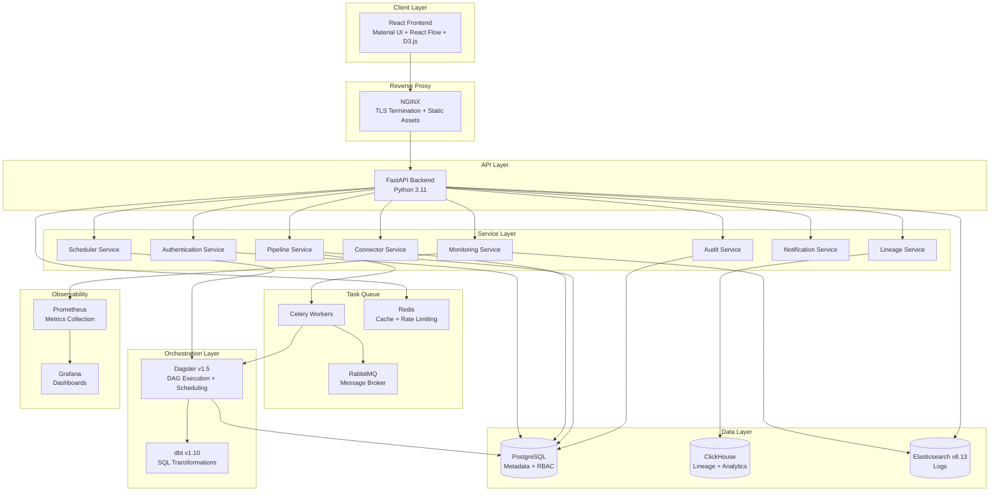
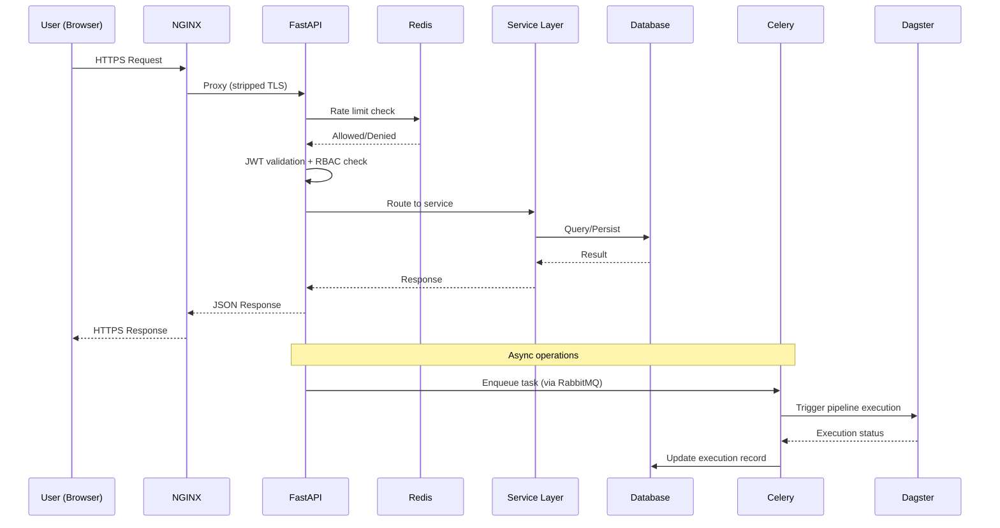
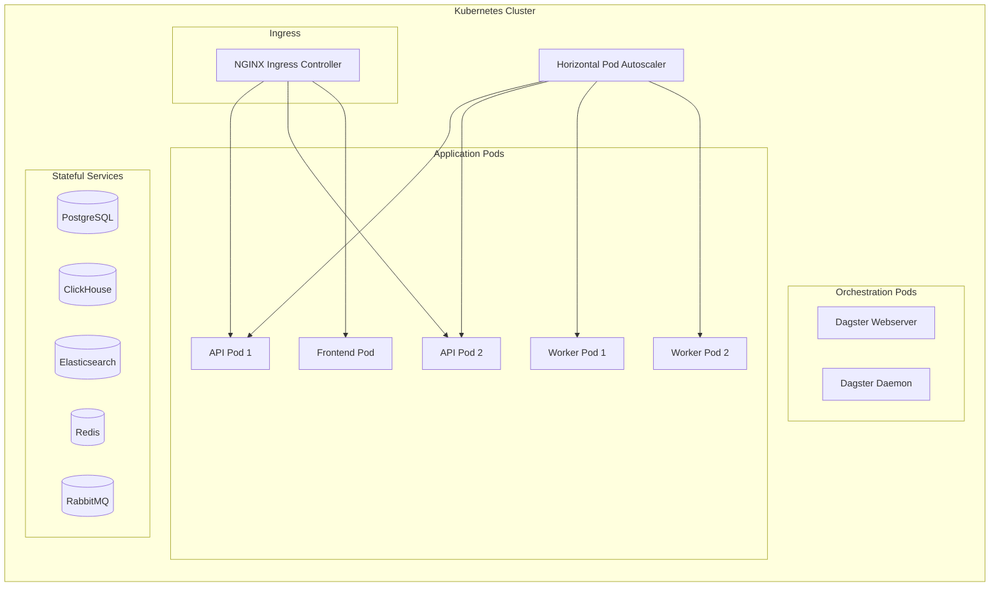
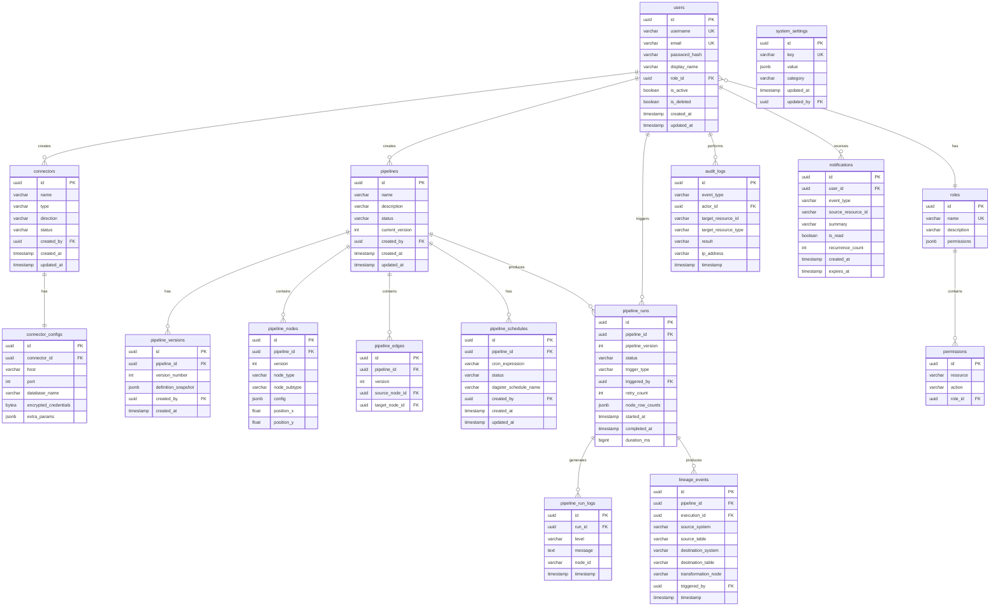
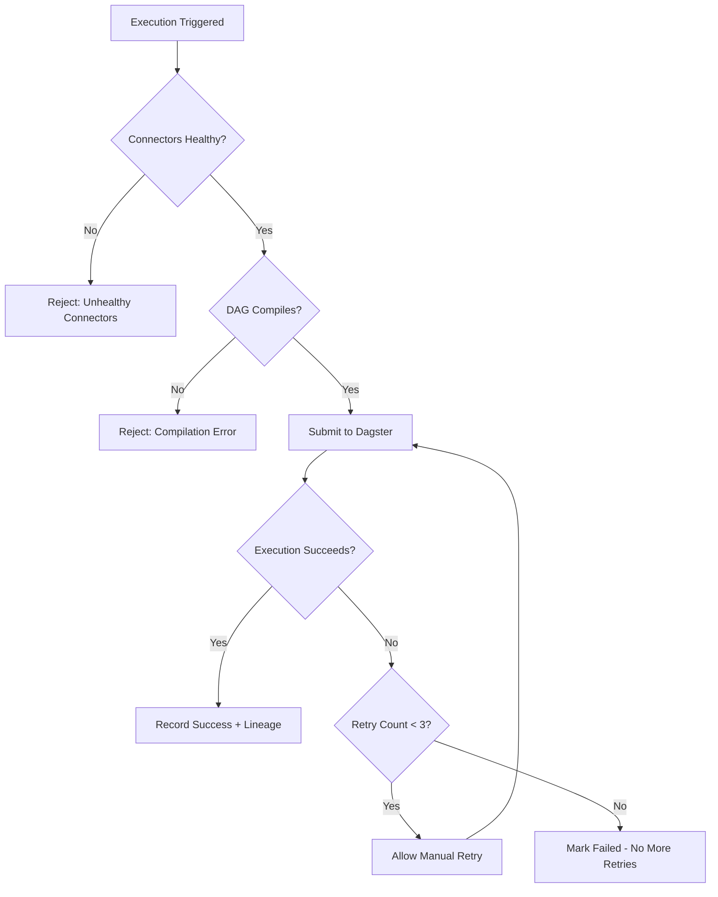

# Design Document: Cloud-Independent Data Infrastructure

## Overview

This design describes the architecture, components, and data models for a cloud-independent, self-service data platform targeting regulated industries (banking, healthcare, government, telecom, defense). The platform enables organizations to build, schedule, monitor, and audit data pipelines entirely on their own infrastructure without reliance on public cloud services.

The system is designed as a modular microservices architecture orchestrated via Docker Compose (development) and Kubernetes (production). It uses a visual drag-and-drop pipeline builder (React Flow) that compiles to Dagster DAGs and dbt models for execution, with comprehensive RBAC, audit logging, data lineage, and air-gapped deployment support.

### Key Design Decisions

1. **Dagster as orchestration engine**: Dagster v1.5 provides native DAG execution, scheduling, retry logic, and observability — avoiding building a custom orchestrator.
2. **dbt for transformations**: Visual transformation nodes compile to dbt v1.10 models, leveraging the SQL engine inside destination warehouses for scalability.
3. **Dual database strategy**: PostgreSQL for transactional/metadata workloads; ClickHouse for analytical query performance on lineage and monitoring data.
4. **Elasticsearch for logs**: Structured log storage with full-text search for rapid log retrieval and configurable retention.
5. **Event-driven notifications**: Celery + RabbitMQ for async task processing and notification dispatch, decoupling event production from consumption.
6. **Air-gapped first**: All dependencies are pinned and bundled; no runtime external network calls; OCI-compliant container images.

## Architecture

### High-Level Architecture Diagram



### Request Flow



### Deployment Architecture



## Components and Interfaces

### 1. Authentication Service

**Responsibility**: User authentication, JWT token management, session lifecycle, password hashing, account lockout.

**Interface**:
```python
class AuthenticationService:
    async def login(self, username: str, password: str, ip_address: str) -> TokenPair
    async def logout(self, access_token: str, refresh_token: str) -> None
    async def refresh_token(self, refresh_token: str) -> TokenPair
    async def reset_password_request(self, user_id: UUID) -> ResetToken
    async def reset_password_confirm(self, token: str, new_password: str) -> None
    async def validate_token(self, token: str) -> TokenClaims
```

**Dependencies**: PostgreSQL (users, sessions), Redis (token blacklist, failed attempt counter), Audit Service.

### 2. Connector Service

**Responsibility**: CRUD operations on connectors, credential encryption/decryption, connection testing, health checks.

**Interface**:
```python
class ConnectorService:
    async def create_connector(self, config: ConnectorCreate, user_id: UUID) -> Connector
    async def update_connector(self, connector_id: UUID, config: ConnectorUpdate) -> Connector
    async def delete_connector(self, connector_id: UUID) -> None
    async def test_connection(self, connector_id: UUID) -> ConnectionTestResult
    async def get_credentials(self, connector_id: UUID) -> DecryptedCredentials
    async def health_check(self, connector_id: UUID) -> HealthStatus
    async def rotate_encryption_key(self, new_key: bytes) -> RotationResult
```

**Dependencies**: PostgreSQL (connectors, connector_configs), Credential Store (AES-256), Notification Service.

### 3. Pipeline Service

**Responsibility**: Pipeline CRUD, DAG validation, version management, compilation to Dagster definitions and dbt models.

**Interface**:
```python
class PipelineService:
    async def create_pipeline(self, definition: PipelineCreate, user_id: UUID) -> Pipeline
    async def update_pipeline(self, pipeline_id: UUID, definition: PipelineUpdate) -> PipelineVersion
    async def validate_dag(self, nodes: list[Node], edges: list[Edge]) -> ValidationResult
    async def compile_to_dagster(self, pipeline_id: UUID, version: int) -> DagsterDefinition
    async def compile_transformations_to_dbt(self, nodes: list[TransformNode]) -> DbtProject
    async def execute_pipeline(self, pipeline_id: UUID, user_id: UUID) -> PipelineRun
    async def retry_execution(self, run_id: UUID, user_id: UUID) -> PipelineRun
    async def get_execution_status(self, run_id: UUID) -> ExecutionStatus
```

**Dependencies**: PostgreSQL (pipelines, pipeline_versions, pipeline_nodes, pipeline_edges), Dagster, dbt, Connector Service, Lineage Service.

### 4. Scheduler Service

**Responsibility**: Schedule CRUD, cron validation, mapping to Dagster schedule definitions, concurrency handling.

**Interface**:
```python
class SchedulerService:
    async def create_schedule(self, pipeline_id: UUID, cron: str, user_id: UUID) -> Schedule
    async def update_schedule(self, schedule_id: UUID, cron: str) -> Schedule
    async def pause_schedule(self, schedule_id: UUID) -> Schedule
    async def resume_schedule(self, schedule_id: UUID) -> Schedule
    async def delete_schedule(self, schedule_id: UUID) -> None
    async def validate_cron(self, expression: str) -> CronValidationResult
```

**Dependencies**: PostgreSQL (pipeline_schedules), Dagster Scheduler, Pipeline Service.

### 5. Audit Service

**Responsibility**: Immutable audit log recording, querying, export, storage capacity monitoring.

**Interface**:
```python
class AuditService:
    async def record_event(self, event: AuditEvent) -> AuditLog
    async def search_logs(self, filters: AuditFilter, page: int, page_size: int) -> PaginatedResult[AuditLog]
    async def export_logs(self, filters: AuditFilter, format: ExportFormat) -> ExportFile
    async def check_storage_capacity(self) -> StorageStatus
```

**Dependencies**: PostgreSQL (audit_logs), Notification Service.

### 6. Lineage Service

**Responsibility**: Lineage event recording, graph traversal, time-range queries.

**Interface**:
```python
class LineageService:
    async def record_lineage_event(self, event: LineageEventCreate) -> LineageEvent
    async def get_lineage_graph(self, table_name: str, depth: int = 10) -> LineageGraph
    async def query_by_time_range(self, start: datetime, end: datetime) -> list[LineageEvent]
    async def get_node_metadata(self, node_id: str) -> LineageNodeMetadata
```

**Dependencies**: ClickHouse (lineage_events), PostgreSQL (pipeline metadata).

### 7. Notification Service

**Responsibility**: Notification generation, deduplication, delivery to UI, retention management.

**Interface**:
```python
class NotificationService:
    async def create_notification(self, event: NotificationEvent) -> Notification
    async def get_user_notifications(self, user_id: UUID, page: int) -> PaginatedResult[Notification]
    async def mark_as_read(self, notification_id: UUID, user_id: UUID) -> None
    async def suppress_duplicate(self, source_id: str, event_type: str) -> bool
    async def cleanup_expired(self) -> int
```

**Dependencies**: PostgreSQL (notifications), Redis (deduplication window), Celery (async delivery).

### 8. Monitoring Service

**Responsibility**: Metrics aggregation, dashboard data, Prometheus export, system health assessment.

**Interface**:
```python
class MonitoringService:
    async def get_dashboard_metrics(self) -> DashboardMetrics
    async def get_system_health(self) -> SystemHealth
    async def query_logs(self, execution_id: UUID, page: int) -> PaginatedResult[LogEntry]
    def expose_prometheus_metrics(self) -> PrometheusMetrics
```

**Dependencies**: Elasticsearch (logs), Prometheus (metrics), PostgreSQL (execution records).

### Inter-Service Communication

All services communicate through:
1. **Synchronous**: Direct function calls within the FastAPI process (services are co-located in the same Python process for v1).
2. **Asynchronous**: Celery tasks via RabbitMQ for long-running operations (pipeline execution, notification dispatch, log indexing).
3. **Event-driven**: Domain events emitted to Celery for cross-cutting concerns (audit logging, notifications).

### API Layer Structure

```
/api/v1/
├── /auth          (login, logout, refresh, reset-password)
├── /users         (CRUD, role assignment)
├── /connectors    (CRUD, test, health-check)
├── /pipelines     (CRUD, validate, execute, retry, versions)
├── /schedules     (CRUD, pause, resume)
├── /monitoring    (dashboard, health, logs)
├── /lineage       (graph, query, node-metadata)
├── /audit         (search, export)
└── /notifications (list, mark-read)
```

## Data Models

### Entity-Relationship Diagram



### Key Data Model Details

**Password Storage**: bcrypt hash with cost factor 12, stored in `users.password_hash`.

**Credential Encryption**: AES-256-GCM with per-connector initialization vector stored alongside encrypted data in `connector_configs.encrypted_credentials`.

**Pipeline Versioning**: Each save creates a new `pipeline_versions` record with a full JSON snapshot of the DAG (nodes, edges, configurations). The `pipelines.current_version` points to the latest.

**Audit Log Immutability**: The `audit_logs` table uses PostgreSQL row-level security and a trigger that prevents UPDATE and DELETE operations.

**Lineage Storage**: `lineage_events` stored in ClickHouse for high-throughput writes and fast analytical queries. Partitioned by month for efficient time-range queries and retention management.

**Rate Limiting**: Sliding window counters stored in Redis with key pattern `rate_limit:{user_id}:{window_start}` and TTL matching the window duration.

**Token Blacklist**: Invalidated JWTs stored in Redis with TTL matching the token's remaining lifetime.

### SQLAlchemy Model Conventions

- All models inherit from a `Base` declarative base with `id` (UUID, primary key), `created_at`, and `updated_at` mixins.
- Relationships use lazy loading by default; explicit `selectinload` for known N+1 patterns.
- Alembic manages schema migrations with auto-generated revision files.
- All timestamps stored as UTC `TIMESTAMP WITH TIME ZONE`.


## Correctness Properties

*A property is a characteristic or behavior that should hold true across all valid executions of a system — essentially, a formal statement about what the system should do. Properties serve as the bridge between human-readable specifications and machine-verifiable correctness guarantees.*

### Property 1: User creation round-trip

*For any* valid username (3–64 alphanumeric/underscore characters), valid email, and valid role, creating a user and then retrieving that user should return an account with identical username, email, and role attributes.

**Validates: Requirements 1.1, 1.2**

### Property 2: Duplicate user rejection identifies correct field

*For any* existing user in the system, attempting to create a new user with either the same username or the same email should be rejected, and the error response should correctly identify which field (username or email) caused the conflict.

**Validates: Requirements 1.7**

### Property 3: User deactivation revokes all access

*For any* user with N active sessions (N >= 0), disabling or deleting the user should result in zero valid sessions and all subsequent authentication attempts being rejected.

**Validates: Requirements 1.3, 1.4**

### Property 4: Role assignment updates permissions immediately

*For any* user and any valid role, assigning the role should result in the user's effective permissions matching exactly the permission set defined for that role on the next API request.

**Validates: Requirements 1.5, 3.1, 3.9**

### Property 5: Password reset token invalidates predecessors

*For any* user, generating a new password reset token should invalidate all previously issued reset tokens for that user, such that only the most recent token is accepted for password reset.

**Validates: Requirements 1.6**

### Property 6: JWT token lifecycle round-trip

*For any* valid user credentials, login should produce a JWT access token and refresh token where: (a) the access token contains correct user claims and expiration, (b) using the refresh token before expiry produces a new valid access token, and (c) after logout both tokens are rejected.

**Validates: Requirements 2.1, 2.4, 2.6**

### Property 7: Account lockout after consecutive failures

*For any* user account, exactly 5 consecutive failed login attempts should lock the account for 15 minutes, during which all login attempts are rejected regardless of credential validity. After the lockout period, the counter resets and valid credentials are accepted.

**Validates: Requirements 2.2, 2.3**

### Property 8: RBAC enforcement on all endpoints

*For any* user role and any API endpoint, access should be granted if and only if the role's permission set includes the required permission for that endpoint. Requests without authentication receive HTTP 401; requests with insufficient permissions receive HTTP 403.

**Validates: Requirements 3.1, 3.7, 3.8**

### Property 9: Credential encryption round-trip survives key rotation

*For any* connector credential value, encrypting it should produce ciphertext that does not contain the plaintext, and decrypting should return the original value. After master key rotation, all credentials should still decrypt to their original values using the new key.

**Validates: Requirements 4.1, 11.1, 11.4**

### Property 10: Credential masking in API responses

*For any* connector with stored credentials, all API responses referencing that connector should replace credential fields with a fixed mask value that reveals no portion of the original credential.

**Validates: Requirements 11.2**

### Property 11: Connector deletion blocked by dependent pipelines

*For any* connector referenced by one or more active pipelines, deletion should be rejected and the error response should include the complete list of dependent pipelines.

**Validates: Requirements 4.3, 4.4**

### Property 12: DAG topology validation

*For any* set of nodes and edges representing a pipeline graph, the validation should: (a) accept edges that follow permitted flow direction (source→transform/destination, transform→transform/destination, destination has no outgoing), (b) reject any edge that would create a cycle, (c) reject graphs exceeding 50 nodes or 100 edges.

**Validates: Requirements 5.3, 5.4, 5.13**

### Property 13: Pipeline save validates completeness and creates version

*For any* pipeline with at least one source node, one destination node, a connected path between them, and all required configuration fields populated, saving should succeed and create a new version. For any pipeline missing these requirements, saving should fail with specific validation errors identifying each issue.

**Validates: Requirements 5.9, 5.10, 5.11**

### Property 14: Node deletion removes connected edges

*For any* DAG and any node within it, deleting the node should remove the node from the pipeline definition and remove all edges where that node is either the source or target.

**Validates: Requirements 5.12**

### Property 15: Dagster definition compilation from valid pipeline

*For any* valid pipeline definition (passes DAG validation), compilation should produce a syntactically valid Dagster repository/asset definition that represents the same DAG topology.

**Validates: Requirements 6.1**

### Property 16: dbt model compilation from transformation nodes

*For any* valid transformation node configuration (Filter, Aggregate, Join, Select, Rename), compilation should produce a syntactically valid dbt model file with correct SQL semantics.

**Validates: Requirements 5.7**

### Property 17: Pipeline execution retry limit enforcement

*For any* failed pipeline execution, the system should allow a maximum of 3 manual retries. The 4th retry attempt should be rejected regardless of execution state.

**Validates: Requirements 6.7**

### Property 18: Pre-execution connector health gate

*For any* pipeline whose referenced connectors include at least one with unhealthy status, execution should be rejected before submission to Dagster, with an error identifying the unhealthy connectors.

**Validates: Requirements 6.9**

### Property 19: Cron expression validation

*For any* string input, the cron validator should accept it if and only if it is a valid 5-field cron expression with a resulting interval of at least 1 minute. Invalid expressions should be rejected with a message indicating the syntax violation.

**Validates: Requirements 7.1, 7.7**

### Property 20: Scheduled execution concurrency queueing

*For any* pipeline with an active running execution, a newly triggered scheduled execution should be queued rather than started, and should begin only after the running execution completes.

**Validates: Requirements 7.5**

### Property 21: Log query pagination correctness

*For any* set of N log entries for an execution and page size 100, requesting page P should return entries in chronological order corresponding to positions [(P-1)*100, min(P*100, N)), with correct total count metadata.

**Validates: Requirements 8.5**

### Property 22: Lineage event completeness

*For any* pipeline execution with K data movement steps, the system should record exactly K lineage events, each containing all required fields: source_system, source_table, destination_system, destination_table, transformation_node (if applicable), pipeline_id, execution_id, triggered_by user, and timestamp.

**Validates: Requirements 9.1**

### Property 23: Lineage graph traversal depth limit

*For any* table in the lineage graph with a chain of upstream/downstream connections of length L, querying lineage for that table should return connections up to depth min(L, 10) in each direction and never exceed 10 levels.

**Validates: Requirements 9.2**

### Property 24: Lineage time-range filtering

*For any* set of lineage events and a time range [start, end], a time-range query should return exactly those events whose timestamps fall within the specified range (inclusive).

**Validates: Requirements 9.6**

### Property 25: Audit log entry structure and immutability

*For any* recorded audit event, the persisted entry should contain all required fields (event_type, actor_id, target_resource_id, timestamp in UTC ISO 8601, ip_address, result), and any subsequent attempt to update or delete the entry should fail.

**Validates: Requirements 10.2, 10.5**

### Property 26: Audit log search correctness

*For any* set of audit log entries and any combination of filters (event_type, user, resource, time_range, result), the search should return exactly the entries matching all specified filters, paginated at 100 entries per page.

**Validates: Requirements 10.3**

### Property 27: Audit log export correctness

*For any* audit log query result set of size N, exporting in CSV or JSON format should produce a valid file containing min(N, 100000) records that match the query filters.

**Validates: Requirements 10.4**

### Property 28: Key rotation rollback on failure

*For any* partial key rotation failure (some credentials re-encrypted, some not), all credentials should remain decryptable using the previous key after rollback, with no data loss.

**Validates: Requirements 11.6**

### Property 29: Air-gapped connector availability

*For any* connector type, in air-gapped deployment mode, the connector should be available if and only if its type is not REST_API. REST API connectors should be marked as disabled with an appropriate message.

**Validates: Requirements 12.5**

### Property 30: Validation error response completeness

*For any* request with M validation errors (M >= 1), the error response should contain exactly M error entries, each including error_code, field_name, rejected_value, and a human-readable message. No internal details (stack traces, queries, paths, hostnames) should be exposed.

**Validates: Requirements 13.3, 16.2, 16.3**

### Property 31: Rate limiting enforcement

*For any* user making requests to an API endpoint, after exceeding the configured threshold (default 100) within a sliding window (default 1 minute), subsequent requests should receive HTTP 429 with a Retry-After header indicating seconds until reset.

**Validates: Requirements 13.4**

### Property 32: Critical event notification targeting

*For any* critical event (pipeline failure, connector health failure, resource threshold breach), a notification should be generated containing the required event-specific fields and delivered to the correct role-based recipient set (pipeline failure → owner + Operators; connector failure → Data_Engineers + Operators; resource threshold → Admins).

**Validates: Requirements 14.1, 14.2, 14.3**

### Property 33: Notification deduplication within suppression window

*For any* event source that triggers a failure notification, if the same source triggers an identical event type within 15 minutes of an existing unacknowledged notification, the new notification should be suppressed and the recurrence_count on the existing notification incremented.

**Validates: Requirements 14.6**

### Property 34: Database connection retry with exponential backoff

*For any* database connection failure during pipeline execution, the system should retry exactly 3 times with delays following exponential backoff (1s, 2s, 4s) before marking the execution as failed.

**Validates: Requirements 16.5**

### Property 35: Health check endpoint response format

*For any* service component, the health check endpoint should return HTTP 200 with a JSON body containing `service_name` and `status` when the service is healthy, and HTTP 503 when unhealthy, within 2 seconds.

**Validates: Requirements 15.6**


## Error Handling

### Error Handling Strategy

The platform uses a layered error handling approach:

```
┌─────────────────────────────────────────┐
│  Global Exception Handler (FastAPI)     │  → Catches unhandled exceptions
│  - Sanitizes internal details           │  → Returns generic 500 response
│  - Logs full stack trace internally     │  → Records in audit log
├─────────────────────────────────────────┤
│  Service Layer Exception Handling       │  → Domain-specific errors
│  - Validation errors → HTTP 422         │  → Structured error arrays
│  - Not found → HTTP 404                 │  → Resource identifier
│  - Conflict → HTTP 409                  │  → Conflicting field
│  - Forbidden → HTTP 403                 │  → Required permission
├─────────────────────────────────────────┤
│  Infrastructure Layer Retry Logic       │  → Transient failures
│  - Database connection retry (3x)       │  → Exponential backoff 1s/2s/4s
│  - Redis connection retry (3x)          │  → Exponential backoff 500ms/1s/2s
│  - Dagster API retry (2x)              │  → Fixed 5s delay
└─────────────────────────────────────────┘
```

### Error Response Format

All API errors follow a consistent structure:

```json
{
  "error": {
    "code": "VALIDATION_ERROR",
    "message": "Request validation failed",
    "details": [
      {
        "error_code": "FIELD_REQUIRED",
        "field": "username",
        "rejected_value": null,
        "message": "Username is required"
      },
      {
        "error_code": "INVALID_FORMAT",
        "field": "email",
        "rejected_value": "not-an-email",
        "message": "Email must be a valid email address"
      }
    ]
  },
  "request_id": "uuid-v4",
  "timestamp": "2024-01-15T10:30:00Z"
}
```

### Error Categories

| HTTP Status | Error Code | Meaning | Retry |
|-------------|-----------|---------|-------|
| 400 | BAD_REQUEST | Malformed request syntax | No |
| 401 | UNAUTHORIZED | Missing or invalid token | No (re-authenticate) |
| 403 | FORBIDDEN | Insufficient permissions | No |
| 404 | NOT_FOUND | Resource does not exist | No |
| 409 | CONFLICT | Resource state conflict | No (resolve conflict) |
| 413 | PAYLOAD_TOO_LARGE | Request exceeds 10MB limit | No (reduce payload) |
| 422 | VALIDATION_ERROR | Input validation failure | No (fix input) |
| 423 | LOCKED | Account locked (after 5 failures) | Yes (after lockout) |
| 429 | RATE_LIMITED | Rate limit exceeded | Yes (after Retry-After) |
| 500 | INTERNAL_ERROR | Unexpected server error | Yes (with backoff) |
| 503 | SERVICE_UNAVAILABLE | Service temporarily down | Yes (with backoff) |

### Pipeline Execution Error Handling



### Security Error Sanitization

All error responses to external clients are sanitized:
- **Removed**: Stack traces, SQL queries, file system paths, internal hostnames, library versions
- **Preserved**: Error code, human-readable message, affected field name, request ID for support correlation
- **Internal logging**: Full error context written to application logs and Elasticsearch for debugging

### Circuit Breaker Pattern (Connector Health)

```python
class ConnectorCircuitBreaker:
    FAILURE_THRESHOLD = 3
    RECOVERY_TIMEOUT = 60  # seconds

    states: CLOSED → OPEN → HALF_OPEN → CLOSED
    # CLOSED: Normal operation, failures counted
    # OPEN: All requests fail fast, notification emitted
    # HALF_OPEN: Single test request allowed after recovery timeout
```


## Testing Strategy

### Overview

The platform uses a dual testing approach combining property-based tests (for universal correctness guarantees) with example-based unit tests (for specific scenarios and edge cases), supplemented by integration and end-to-end tests.

### Property-Based Testing

**Library**: [Hypothesis](https://hypothesis.readthedocs.io/) (Python) for backend property tests.

**Configuration**:
- Minimum 100 iterations per property test (via `@settings(max_examples=100)`)
- Each property test tagged with: `Feature: cloud-independent-data-infrastructure, Property {N}: {property_text}`
- Dedicated `tests/properties/` directory organized by service

**Property Test Coverage**:

| Property | Service | Focus |
|----------|---------|-------|
| 1–5 | Authentication | User CRUD, tokens, lockout |
| 6–8 | Authentication/RBAC | JWT lifecycle, role enforcement |
| 9–10 | Connector | Encryption round-trip, masking |
| 11 | Connector/Pipeline | Deletion dependency check |
| 12–14 | Pipeline | DAG validation, versioning, node ops |
| 15–16 | Pipeline | Compilation to Dagster/dbt |
| 17–18 | Pipeline Execution | Retry limit, health gate |
| 19–20 | Scheduler | Cron validation, concurrency |
| 21 | Monitoring | Log pagination |
| 22–24 | Lineage | Event completeness, traversal, filtering |
| 25–27 | Audit | Structure, search, export |
| 28–29 | Credential/Deployment | Key rotation, air-gapped mode |
| 30–31 | API | Validation responses, rate limiting |
| 32–33 | Notification | Targeting, deduplication |
| 34–35 | Infrastructure | Retry logic, health checks |

### Unit Testing

**Framework**: pytest with pytest-asyncio for async service tests.

**Focus areas**:
- Role-specific permission examples (Admin, Data_Engineer, Operator, Auditor, Viewer)
- Specific connector type instantiation (PostgreSQL, MySQL, CSV, Excel, REST)
- Pipeline builder node type examples
- Specific cron expression examples (valid and invalid)
- Notification content format examples
- Dashboard metric calculation examples

**Conventions**:
- One test file per service module: `tests/unit/test_{service}.py`
- Test factories using `factory_boy` for generating test objects
- Mocked external dependencies (Dagster, Elasticsearch, ClickHouse)

### Integration Testing

**Framework**: pytest with `httpx.AsyncClient` for API-level testing against a running FastAPI app.

**Infrastructure**: Docker Compose test environment with PostgreSQL, Redis, RabbitMQ, Elasticsearch.

**Coverage**:
- Every API endpoint defined in the OpenAPI spec
- Database transaction rollback between tests
- Connector health check flows (using test database instances)
- Dagster API interactions (using Dagster test utilities)
- Elasticsearch log indexing and retrieval
- Audit log recording across service boundaries

### End-to-End Testing

**Framework**: pytest + httpx for API workflows; Playwright for UI workflows.

**Critical workflows tested**:
1. Login → Create Connector → Test Connection → Build Pipeline → Save → Execute → View Lineage
2. Login → Create Schedule → Verify Execution Triggered → View Logs
3. Admin Login → Create User → Assign Role → Verify Permissions
4. Pipeline Failure → Notification Generated → Operator Views Failure → Retry

### Test Data Strategy

- **Factories**: `factory_boy` factories for all domain models (users, connectors, pipelines, etc.)
- **Fixtures**: Pytest fixtures providing pre-configured test states (user with sessions, pipeline with nodes)
- **No network access**: All test data self-contained; external services mocked or containerized
- **Hypothesis strategies**: Custom strategies for generating valid/invalid DAGs, cron expressions, usernames, emails

### CI Pipeline

```yaml
# GitHub Actions workflow structure
stages:
  - lint (ruff, mypy, eslint)
  - unit-tests (pytest --cov, minimum 80% line coverage)
  - property-tests (pytest tests/properties/ --hypothesis-seed=random)
  - integration-tests (docker-compose up + pytest tests/integration/)
  - e2e-tests (pytest tests/e2e/)
  - build (docker build for each service)
  - publish (push to container registry)

timeout: 30 minutes
merge-gate: all stages must pass, coverage >= 80%
```

### Test Directory Structure

```
tests/
├── unit/
│   ├── test_auth_service.py
│   ├── test_connector_service.py
│   ├── test_pipeline_service.py
│   ├── test_scheduler_service.py
│   ├── test_audit_service.py
│   ├── test_lineage_service.py
│   ├── test_notification_service.py
│   └── test_monitoring_service.py
├── properties/
│   ├── test_user_properties.py
│   ├── test_auth_properties.py
│   ├── test_rbac_properties.py
│   ├── test_connector_properties.py
│   ├── test_pipeline_dag_properties.py
│   ├── test_pipeline_compilation_properties.py
│   ├── test_scheduler_properties.py
│   ├── test_lineage_properties.py
│   ├── test_audit_properties.py
│   ├── test_notification_properties.py
│   ├── test_validation_properties.py
│   └── test_infrastructure_properties.py
├── integration/
│   ├── test_auth_api.py
│   ├── test_connector_api.py
│   ├── test_pipeline_api.py
│   ├── test_schedule_api.py
│   ├── test_monitoring_api.py
│   ├── test_lineage_api.py
│   ├── test_audit_api.py
│   └── test_notification_api.py
├── e2e/
│   ├── test_pipeline_workflow.py
│   ├── test_scheduling_workflow.py
│   ├── test_user_management_workflow.py
│   └── test_failure_recovery_workflow.py
├── factories/
│   ├── user_factory.py
│   ├── connector_factory.py
│   ├── pipeline_factory.py
│   └── audit_factory.py
└── conftest.py
```
